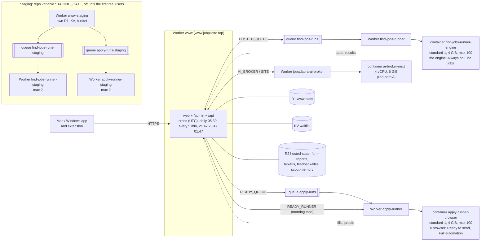

# jobadabra-web (private)

The website, `/admin`, and the CI jobs that feed them. Moved out of the public `GarryOne/jobadabra` on 19-20 Oct 2026.

**Rule: private may read public, public never reads private.** This repo only runs laid over a tree of the public repo
(the site imports shared validators from `extension/`, `desktop/lib/`, `app-core/src/`, `config/`).

## Work here
- `tools/site-run.sh <cmd>`: runs a command in `.overlay` (public tree + this repo), rebuilt when older than an hour.
- `tools/overlay.sh <out> [ref]`: build that tree by hand. `tools/tree.sh`: the same, for CI.
- `tools/site-guards.sh <tree> [<this repo>]`: the public tests that read site files plus this repo's own tests.
- No `ship.sh` here: open a normal PR; the required check is the job "All checks passed" (`tests.yml`).

## Layout (top level, by audience; 21 Oct 2026)
| Folder | What |
|---|---|
| `website/` `admin/` `api/` `shared/` | the public pages, /admin, what the apps call, what both use (see `website/README.md`) |
| `workers/` | `www` (the ONE Worker serving web + admin + api), `hosted-runner` (Worker `find-jobs-runner`), `ready-runner` (Worker `apply-runner`), `ai-broker` (Worker `jobadabra-ai-broker`); the map is under "The cloud" below |
| `ops/hosted/` | the two container images' own files: `Dockerfile` (Always on) and `ready-fill/` (Dockerfile, `main.mjs`, `image-check.mjs`); the code they run is the public repo's (`src/`, `desktop/ready-fill/`) |
| `ops/db/migrations/` | D1 migrations |
| `test/` | one folder per kind, then per area ([TESTS.md](TESTS.md)); `test/guards/boundary.test.js` guards the import directions. Run: `node --test "test/**/*.test.js"` |
| `ops/media/` | the product-media recorder (videos and stills for the site); run it with `tools/media.sh` (by hand, never CI) |
| `ops/jobs/` | scheduled jobs that feed /admin (digest, ops overview, changelog, e2e intel, hosted e2e, Lab uploads) |
| `tools/` | the dev kit (overlay, tree, site-run, site-guards, staging) |
| `test/python/`, `test/media/` | tests that run inside the public tree's own harness (python / desktop): the joined tree has them at `tests/` and `desktop/test/` (`tools/layout-map.txt`) |

## The cloud (what runs on Cloudflare; 13 Nov 2026)
Owner, 13 Nov 2026: "store in the readme a graph with the runners and workers… basically this inventory". Keep it true when a Worker, queue, container or store is added, renamed or deleted.

- **Alerts** (the 5-minute tick, `shared/cap-alerts.js`, `shared/cloud-health.js`): each runner 🟠 at 80 live / 🔴 when full and a start was refused; each container's memory and disk 🟠 80% / 🔴 95%, CPU p95 80% / 100%; each Worker's errors; failed Always on runs and Apply fills.
- **Staging gate** (repo variable `STAGING_GATE`, off): on, each production deploy goes to its staging copy first (site: every route asked; runners: the new container comes up) and a red staging stops production.
- **Deploys**: `site.yml` (www, on push; makes the queues and waits for `apply-runner`), `release-ready-runner.yml` (on push), `release-hosted-runner.yml` (public-watch or by hand), `release-ai-broker.yml` (the AI broker, on push).

## Contract with the public repo
`docs/site-routes.json` (public) lists every route the app calls. Two tests keep it true: `test/unit/workers/www/site-routes.test.js` (here) and `desktop/test/site-routes.test.js` (public).

## CI
`tests.yml` (PRs, push, daily against newest public main), `site.yml` (deploy), `public-watch.yml` (every 6 hours: a public change that a deploy bundles dispatches the deploy), plus the scheduled jobs moved from public (digest, changelog, ops overview, e2e intel, hosted e2e, random draw, search lab).

## Secrets (set on this repo by the owner; never in code)
`CLOUDFLARE_API_TOKEN`, `CLOUDFLARE_ACCOUNT_ID`, `AI_COST_PUBLISH_KEY`, `SELFHEAL_PUBLISH_KEY`, `REPLAYS_PUBLISH_KEY`, `BUILDLOG_TELEGRAM_TOKEN`, `BUILDLOG_TELEGRAM_CHAT`;
Lab: `RANDOM_DRAWS_ANTHROPIC_KEY`, `CI_APP_ID`, `CI_APP_PRIVATE_KEY`. `NET_RECORD_KEY` and `NET_RECORDS_READ_TOKEN` are unused since the old 6-recording replay was retired (10 Nov 2026); they may be deleted.

Never deploy Worker `www` from here and from public `site.yml` at the same time.

**The tidy top level and the joined tree** (owner, 2 Nov 2026): the repo root shows few, grouped folders; `tools/layout-map.txt` says where each lands in the joined tree (this repo laid over the public one), so `website/` runs as `web/` with no import or workflow step changed. `tools/lay-private.sh` is the one place that applies the map (overlay.sh, tree.sh, hero.sh); a test is `test/tooling/lay-private.test.js`.
